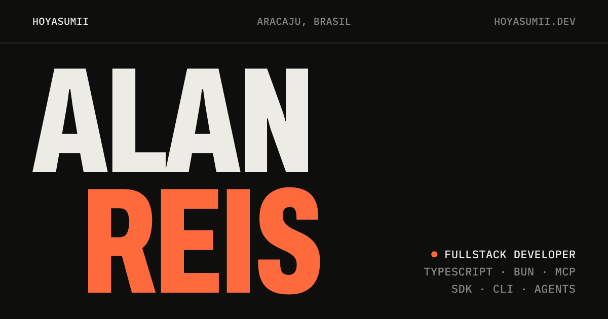

<a href="https://hoyasumii.dev">
  <picture>
    <source media="(prefers-color-scheme: dark)" srcset="packages/brand/images/og-dark.png">
    <source media="(prefers-color-scheme: light)" srcset="packages/brand/images/og.png">
    
  </picture>
</a>

[English](README.md) · **Português**

🤓☝🏻 Sou **Desenvolvedor Fullstack**, de Aracaju, Brasil.

Escrevo **TypeScript** antes de tudo, com **Bun + Elysia** no backend. Gosto de backends modulares com DDD e contratos tipados, e de ferramentas para devs que funcionam igual no código, no terminal e em agentes de IA (**SDK + CLI + MCP**).

Projetos, experiência e artigos estão em **[hoyasumii.dev](https://hoyasumii.dev)**. Alguns para começar:

- [**Skill Icons**](https://github.com/Hoyasumii/skill-icons): 600+ ícones de tecnologias como API de SVG, builder, servidor MCP e pacote npm.
- [**Nyx**](https://github.com/Hoyasumii/nyx): apresente slides PDF ou PPTX em tela cheia, direto no navegador.
- [**Roastery**](https://github.com/roastery-cms): um CMS headless com Bun, Elysia, Prisma e Redis, dividido em pacotes pequenos.
- **SDK · MCP · CLI** para [Plane](https://github.com/Hoyasumii/plane), [SigNoz](https://github.com/Hoyasumii/signoz), [LinkedIn](https://github.com/Hoyasumii/linkedin) e [LibreTranslate](https://github.com/Hoyasumii/libretranslate).

## 🧠 Stack

**Runtime & Backend**
> 

**Frontend**
> 

**Mobile & Desktop**
> 

**Dados**
> 

**Cloud & DevOps**
> 

**Qualidade & Ferramentas**
> 

**IA & Observabilidade**
> 

**Também já usei**
> 

## 📫 Contato

---

O código deste repositório está sob a [licença MIT](LICENSE).
